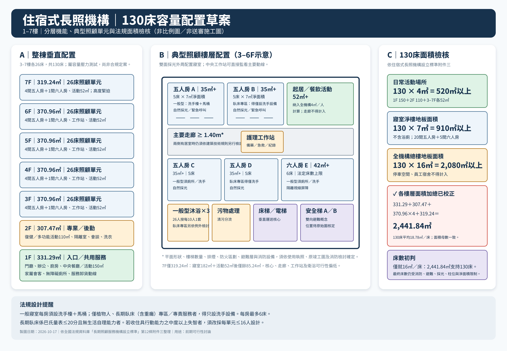

# 住宿式長照機構 130 床容量配置與法規查證

> 文件性質：前期可行性評估及空間配置草案  
> 建築樓層：地上 1–7 樓  
> 規劃規模：3–7 樓各 26 床，合計 130 床  
> 整理日期：2026 年 10 月 17 日  
> 注意：本文件及配置圖不是建築師簽證圖、消防圖或正式送審圖。

## 一、概念配置圖



- [開啟 PNG 配置圖](住宿式長照機構_130床概念配置圖.png)
- [開啟可編輯 SVG 原圖](住宿式長照機構_130床概念配置圖.svg)

## 二、已知樓地板面積

| 樓層 | 樓地板面積 |
|---|---:|
| 1 樓 | 331.29 ㎡ |
| 2 樓 | 307.47 ㎡ |
| 3 樓 | 370.96 ㎡ |
| 4 樓 | 370.96 ㎡ |
| 5 樓 | 370.96 ㎡ |
| 6 樓 | 370.96 ㎡ |
| 7 樓 | 319.24 ㎡ |
| **各樓層加總** | **2,441.84 ㎡** |

### 面積合計確認

各樓層面積加總如下，與使用者指定的總樓地板面積 **2,441.84 ㎡** 相符：

```text
331.29 + 307.47 + 370.96 × 4 + 319.24
= 2,441.84 ㎡
```

正式辦理床數試算、籌設計畫書及建築圖說時，仍應以建物謄本、使用執照或核准竣工圖確認其中是否包含依法不得計入的停車空間或員工宿舍。

## 三、建議樓層配置

| 樓層 | 建議用途 | 床數 | 主要空間 |
|---|---|---:|---|
| 7 樓 | 住宿照顧單元 | 26 床 | 4 間五人房、1 間六人房、工作站及活動空間；面積高度緊迫 |
| 6 樓 | 住宿照顧單元 | 26 床 | 4 間五人房、1 間六人房、工作站、衛浴及 52 ㎡活動空間 |
| 5 樓 | 住宿照顧單元 | 26 床 | 4 間五人房、1 間六人房、工作站、衛浴及 52 ㎡活動空間 |
| 4 樓 | 住宿照顧單元 | 26 床 | 4 間五人房、1 間六人房、工作站、衛浴及 52 ㎡活動空間 |
| 3 樓 | 住宿照顧單元 | 26 床 | 4 間五人房、1 間六人房、工作站、衛浴及 52 ㎡活動空間 |
| 2 樓 | 專業、活動及後勤空間 | 0 床 | 復健／多功能活動約 110 ㎡、隔離室、會談室、洗衣及庫房 |
| 1 樓 | 入口及共用服務 | 0 床 | 門廳、行政、廚房、會客及中央餐廳／活動約 150 ㎡ |
| **合計** |  | **130 床** |  |

### 配置原則

1. 住宿照顧區集中於 3–7 樓，使許可設立範圍位於連續樓層。
2. 每個照顧樓層暫按 26 床配置，房型為 4 間五人房及 1 間六人房。
3. 每層設置護理工作站，使工作人員能直接監看主要走廊及公共空間。
4. 寢室沿建築物外周配置，以取得自然採光及通風。
5. 電梯、床梯、安全梯及設備管道集中形成垂直核心。
6. 清潔物品、污物及廢棄物動線應與住民、餐食及訪客動線適當分離。
7. 7 樓只有 319.24 ㎡；扣除寢室最低 182 ㎡及暫分配活動空間 52 ㎡後，僅餘 85.24 ㎡容納走廊、工作站、衛浴、樓梯、電梯、牆體及管道，配置 26 床的實際可行性偏低。

## 四、130 床法規面積初步試算

### 1. 總樓地板面積

住宿式長照機構平均每床應有 **16 ㎡以上**：

```text
130 床 × 16 ㎡／床 = 2,080 ㎡
```

以總樓地板面積 2,441.84 ㎡計算：

```text
2,441.84 ÷ 130 = 18.7834 ㎡／床
```

計算結果高於每床 16 ㎡的最低門檻。但停車空間及員工宿舍不得計入，正式計算仍須依核准圖說確認可計入面積。

### 2. 寢室面積

寢室平均每人樓地板面積應有 **7 ㎡以上**，且不包括浴廁面積：

```text
130 人 × 7 ㎡／人 = 910 ㎡
```

本案概念配置為：

```text
五人房至少 35 ㎡，六人房至少 42 ㎡
20 間五人房 × 35 ㎡ + 5 間六人房 × 42 ㎡ = 910 ㎡
```

實際設計宜預留牆體、柱位、洗手設備、收納、床邊操作及輪椅迴轉所需餘裕，不宜只按最低面積繪製。

### 3. 日常活動場所

餐廳、交誼及休閒活動等日常活動場所，平均每人應有 **4 ㎡以上**：

```text
130 人 × 4 ㎡／人 = 520 ㎡
```

本案概念分配：

```text
1 樓中央餐廳／活動空間：約 150 ㎡
2 樓多功能活動空間：約 110 ㎡
3–7 樓活動空間：52 ㎡ × 5 層 = 260 ㎡
合計：520 ㎡
```

日常活動場所可以包括多功能活動空間、交誼空間、客廳、餐廳、休憩設施及活動室，**走廊不得計入**。

### 4. 沐浴設備

一般照顧區每 10 人應有一套洗澡設備，未滿 10 人以 10 人計：

```text
每層 26 人按每 10 人一套計算 = 一般型每層至少 3 套
5 個住宿樓層 × 3 套 = 全機構至少 15 套
```

寢室內設有符合規定的衛浴設備者，得依規定併計。

## 五、寢室設計重點

- 寢室不得設於地下樓層。
- 一般寢室平均每人至少 7 ㎡，且每間最多 6 床。
- 一般住宿式長照寢室每間均應設洗手檯及馬桶。
- **只有設專區或專責提供植物人、長期臥床（含重癱）者服務時，寢室才可僅設洗手設備，不設房內馬桶。**
- 法規所稱長期臥床（含重癱），是指經巴氏量表評估 20 分以下、無生活自理能力者。
- 此例外必須反映在核准的服務對象、專區劃設及營運方式，不宜用於一般失能住民房間。
- 寢室應具有自然採光窗、良好通風及充足光線。
- 每床應設櫥櫃或床頭櫃及緊急呼叫系統。
- 床邊與鄰床的距離至少 80 公分。
- 床尾與床尾側牆壁的距離至少 1 公尺。
- 寢室至少一扇門的淨寬應達 80 公分以上。
- 二床以上寢室應設隔離視線的屏障物。
- 寢室應可由走廊直接進入，不得穿越其他寢室。
- 寢室的 7 ㎡／人面積不包括浴廁面積。

## 六、其他必要空間及設備

### 每一照顧樓層

- 護理工作站及準備區
- 工作臺、工作車或治療車
- 護理紀錄存放設施
- 藥品、醫療器材存放櫃及專用冰箱
- 簡易急救設備
- 污物或醫療廢棄物收集設備
- 無障礙衛浴設備
- 扶手、緊急呼叫、防滑及適當照明
- 被服、用品、雜物及輪椅固定儲放空間

### 全機構

- 隔離室，並具有獨立空調及衛浴設備
- 污物處理室
- 廚房及符合衛生要求的餐具洗滌、沖洗與殺菌設備
- 空調設備及火警連動切斷功能
- 緊急應變應勤裝備
- 逃生滑墊或軟式擔架的固定擺放設施或空間
- 社會工作、會談、復健、洗衣及庫房等營運所需空間

## 七、走廊、無障礙與避難提醒

- 照顧區走廊寬度至少 140 公分。
- 走廊兩側均設居室時，走廊寬度仍須依《建築技術規則》另行檢討。
- 主要走道台階處應設推床或輪椅可使用的專用斜坡道。
- 照顧區、餐廳、走道、樓梯及平台應設欄杆或扶手。
- 樓梯及走道地面應防滑，並有適當照明。
- 安全梯數量、步行距離、排煙、防火區劃、避難層、緊急進口及消防設備，須依原建築圖說與實際用途另行檢討。
- 住宿式長照機構的許可設立樓層原則上最高至地面 10 樓，本案 1–7 樓不超過此項樓層限制。

## 八、失智照顧的特別限制

若收住中度以上且具行動能力的失智症服務使用者達 4 床以上，不能直接沿用本文件的 26 床單元配置，尚須符合：

- 每間寢室最多 4 床。
- 四人寢室床數不得超過該單元總床數的二分之一。
- 每一照顧單元不得超過 16 人。
- 每一單元除寢室外，應設客廳、餐廳、簡易廚房及衛浴等基本生活設施。
- 行動迴路應具有均勻、充足的照明及防反光措施。

因此，預定服務對象會直接影響床數、單元大小、人員編制及平面配置，應在正式建築設計前確定。

## 九、130 床可行性初步結論

130 床若只檢查全機構總樓地板面積，仍高於最低門檻：

- 130 床最低總樓地板面積：2,080 ㎡。
- 使用者指定總面積：2,441.84 ㎡，相當於每床 18.78 ㎡。
- 各樓層實際加總：2,441.84 ㎡，相當於每床 18.78 ㎡。
- 寢室至少需要 910 ㎡。
- 日常活動場所至少需要 520 ㎡。

但總樓地板面積達標不等於可以核准 130 床。尤其 7 樓的面積餘裕很小，正式套繪後很可能需要減床。最終床數仍受下列條件限制：

1. 原建築物用途及是否需要辦理變更使用。
2. 土地使用分區及容許使用。
3. 樓梯、電梯及床梯的數量與尺寸。
4. 消防安全設備、防火區劃、排煙及避難距離。
5. 寢室自然採光、通風及有效淨面積。
6. 建築柱位、管道間及既有固定隔間。
7. 無障礙設施及衛浴迴轉空間。
8. 廚房、隔離室、污物處理、工作站及後勤設施的實際占用面積。
9. 服務對象是否包含失智症、呼吸器依賴、植物人或長期臥床者。

## 十、正式送審前應取得的資料

- 土地及建物登記謄本
- 建築物使用執照
- 核准竣工平面圖
- 各樓層可計入面積明細
- 都市計畫土地使用分區資料
- 現況測量圖
- 消防安全設備現況及檢修資料
- 電梯與樓梯尺寸
- 建築結構柱位及設備管道位置
- 預定服務對象及床數分配
- 廚房供餐方式及洗衣方式
- 苗栗縣主管機關要求的籌設及設立文件清單

## 十一、法規依據

1. [長期照顧服務機構設立標準](https://law.moj.gov.tw/LawClass/LawAll.aspx?pcode=L0070048)
2. 上述標準第 12 條附件三「住宿式長照機構設立標準表」
3. [長期照顧服務機構設立許可及管理辦法](https://law.moj.gov.tw/LawClass/LawAll.aspx?pcode=L0070044)

> 法規及地方政府審查要求可能調整。正式申請時，應再向苗栗縣政府主管機關、建築管理及消防主管機關確認最新規定。
